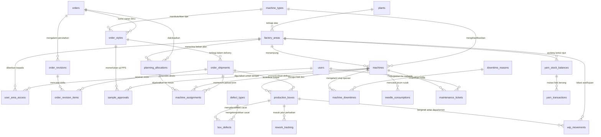

# Blueprint Arsitektur Database Enterprise: `A-ERP` (Knitting Division)
*Transformasi Arsitektur Database Manufaktur Rajut: Konsolidasi 64 Tabel Legacy `capacity_system` Menjadi 22 Tabel Inti Berkinerja Tinggi Berbasis Domain-Driven Design (DDD)*

---

## 1. Latar Belakang & Ringkasan Eksekutif

Sistem manufaktur rajut eksisting (`capacity_system`) telah beroperasi melayani pencatatan order, perencanaan mesin rajut (*planning*), pelaporan produksi box harian, penanganan barang cacat (*BS/reject*), perpindahan WIP (*outflow*), perbaikan (*repair*), hingga pemeliharaan mesin (*maintenance/downtime*).

Namun, seiring waktu dan perkembangan kebutuhan operasional lapangan, database mengalami **Table Sprawl** yang masif:
* **Total 64 Tabel** aktif di database produksi.
* **Volume Data:** Melampaui **13 Juta baris data transaksi**.
* **Kelemahan Kritis:**
  1. **Redundansi & Inkonsistensi:** Terdapat 8 tabel berbeda untuk mengelola mesin, 3 tabel terpisah untuk pembatalan order, dan 9 tabel untuk tiket mekanik/downtime.
  2. **String-Based Foreign Key:** Relasi antar tabel vital (seperti `apsperstyle` ke `produksi` dan `planning`) mengandalkan `master_model` / `no_model` bertipe `VARCHAR(35)`, yang lambat saat di-JOIN pada jutaan baris data dan rawan spasi ganda / *case sensitivity*.
  3. **God-Mode Update Sisa:** Kolom `sisa` dihitung dan di-update secara statis ke baris pesanan, menyebabkan *race conditions*, inkonsistensi kalkulasi, dan perlunya rekalkulasi manual berulang.
  4. **Pemisahan Delivery yang Merusak ID:** Pergeseran tanggal kirim (*reschedule delivery*) memecah ID baris order, berisiko memutuskan relasi dengan alokasi mesin yang sedang berjalan.

**Proyek A-ERP** lahir sebagai generasi baru sistem ERP manufaktur terintegrasi. Dokumen ini menetapkan spesifikasi skema database ideal untuk modul inti pabrik rajut dengan memadatkan 64 tabel warisan menjadi **22 tabel enterprise yang kokoh, terindeks secara presisi, dan mendukung pemartisian (partitioning) untuk skala puluhan juta transaksi**.

---

## 2. Inventaris Realitas Lapangan (Audit 64 Tabel Legacy)

Berdasarkan audit langsung pada database produksi `capacity_system`, berikut adalah peta 64 tabel eksisting dan volumenya:

```text
=== DAFTAR 64 TABEL EKSISTING CAPACITY_SYSTEM (VOLUME DATA: ~13 JUTA BARIS) ===
 1. apsperstyle               :   284.018 baris    33. master_downtime           :       115 baris
 2. area_machine              :       336 baris    34. master_flow_proses        :       108 baris
 3. areas                     :        23 baris    35. master_maintenance        :        58 baris
 4. audit_logs                : 1.269.937 baris    36. master_mc                 :         7 baris
 5. bs_mesin                  : 3.187.613 baris    37. master_product_type       :       533 baris
 6. data_booking              :    15.276 baris    38. mc_checklist_item         :       112 baris
 7. data_bs                   : 1.061.039 baris    39. mesin_perinisial          :    13.932 baris
 8. data_cancel               :     4.044 baris    40. mesin_pernomor            :    10.889 baris
 9. data_cancel_order         :       163 baris    41. mesin_planning            :         0 baris
10. data_cylinder             :        11 baris    42. migrations                :       155 baris
11. data_libur                :        84 baris    43. monthly_mc                :        24 baris
12. data_maintenance          :    15.285 baris    44. out_area                  :     3.265 baris
13. data_mesin                :       223 baris    45. out_perbaikan             :   152.126 baris
14. data_mesin_wip            :       106 baris    46. outflow                   : 1.344.199 baris
15. data_model                :     8.532 baris    47. pemasukan_stock_area      :        11 baris
16. data_produksi             :         0 baris    48. pengaduan                 :       578 baris
17. data_service              :       907 baris    49. pengaduan_reply           :       934 baris
18. detail_area_machine       :     2.075 baris    50. penggunaan_jarum          :         0 baris
19. detail_planning           :     6.554 baris    51. perbaikan_area            :   841.084 baris
20. downtime                  : 1.382.544 baris    52. planning_rombak           :         7 baris
21. estimasi_spk              :    25.040 baris    53. pps                       :    20.889 baris
22. estimated_planning        :     4.900 baris    54. produksi                  : 1.895.052 baris
23. history_planning          :        11 baris    55. running_mc_wip            :         1 baris
24. history_revisi            :     2.222 baris    56. stock_area                :     3.502 baris
25. history_smv               :   171.734 baris    57. stock_perbaikan           :    15.855 baris
26. holidays                  :         0 baris    58. stok_pdk                  :       263 baris
27. ie_target                 :     2.630 baris    59. supermarket_area          :         1 baris
28. kebutuhan_area            :        80 baris    60. tanggal_planning          :    51.386 baris
29. kebutuhan_mesin           :       502 baris    61. target_export             :         6 baris
30. login_attempts            :       378 baris    62. transfers                 :       184 baris
31. machines                  :     3.036 baris    63. user                      :        92 baris
32. master_deffect            :       132 baris    64. user_areas                :       165 baris
```

---

## 3. Matriks Konsolidasi (Mapping 64 Tabel Lama $\rightarrow$ 22 Tabel Inti A-ERP)

| No | Kluster / Domain DDD | 64 Tabel Lama (Legacy) | 22 Tabel Baru (A-ERP) | Nilai Tambah & Rasionalisasi |
| :--- | :--- | :--- | :--- | :--- |
| **1** | **Master Lantai Pabrik** | `areas`, `area_machine`, `detail_area_machine`, `user_areas` (4 tabel) | `plants`<br>`factory_areas`<br>`user_area_access` | Standarisasi hierarki multi-pabrik (*Plant* $\rightarrow$ *Area/Line*) dengan kontrol akses pengguna berbasis relasi baku. |
| **2** | **Master Inventaris Mesin** | `machines`, `data_mesin`, `master_mc`, `data_cylinder` (4 tabel) | `machine_types`<br>`machines` | Mengkonsolidasi 3.036 unit mesin rajut ke master tunggal ber-ID bigint, mengisolasi tipe silinder, diameter, dan jarum. |
| **3** | **Manajemen Order & SKU** | `data_model`, `apsperstyle`, `master_product_type`, `history_smv` (4 tabel) | `orders`<br>`order_styles` | Memisahkan identitas PO pembeli (*order level*) dari varian teknis SKU (*style, warna, size, target SMV*). |
| **4** | **Jadwal Pengiriman (Delivery)**| `apsperstyle` (kolom delivery & qty) (1 tabel) | `order_shipments` | Pemisahan 1:N fundamental. Pergeseran delivery tidak lagi memecah baris order atau menghilangkan riwayat alokasi mesin. |
| **5** | **Audit Revisi & Pembatalan** | `history_revisi`, `data_cancel_order`, `data_cancel` (3 tabel) | `order_revisions`<br>`order_revision_items` | Menggabungkan audit riwayat revisi dan rekonsiliasi selisih pengurangan/pembatalan order secara otomatis. |
| **6** | **Pre-Production Sample (PPS)** | `pps` (1 tabel) | `sample_approvals` | Digital sign-off multi-level (*Mekanik* $\rightarrow$ *QA* $\rightarrow$ *Merchandiser* $\rightarrow$ *Follow Up*) sebelum order dirilis jalan. |
| **7** | **Planning & Alokasi Mesin** | `detail_planning`, `estimated_planning`, `tanggal_planning`, `mesin_pernomor`, `mesin_perinisial`, `mesin_planning`, `planning_rombak`, `history_planning` (8 tabel) | `planning_allocations`<br>`machine_assignments` | Menghilangkan 8 tabel tumpang tindih. Alokasi mesin dan target harian dikelola secara deklaratif dan dinamis. |
| **8** | **Kapasitas IE & Target Makro**| `kebutuhan_mesin`, `kebutuhan_area`, `monthly_mc`, `ie_target`, `target_export`, `estimasi_spk` (6 tabel) | `capacity_forecasts`<br>`monthly_targets` | Engine kalkulasi beban kapasitas lini dan target bulanan untuk manajemen pabrik. |
| **9** | **Eksekusi Output Rajut** | `produksi`, `data_produksi`, `stok_pdk` (3 tabel) | `production_boxes` *(Partitioned)* | Optimasi performa untuk 1,89 juta+ box rajut dengan indeks komposit integer dan pemartisian berbasis rentang tanggal. |
| **10** | **Quality Control & Rework** | `bs_mesin`, `data_bs`, `perbaikan_area`, `out_perbaikan`, `stock_perbaikan`, `master_deffect` (6 tabel) | `defect_types`<br>`box_defects`<br>`rework_tracking` | Rantai kualitas terintegrasi: deteksi cacat per box $\rightarrow$ routing perbaikan $\rightarrow$ hasil perbaikan (lolos/BS murni). |
| **11** | **WIP Routing Antar Ruang** | `master_flow_proses`, `outflow`, `out_area`, `running_mc_wip`, `data_mesin_wip`, `transfers`, `supermarket_area` (7 tabel) | `flow_templates`<br>`flow_steps`<br>`wip_movements` | Normalisasi 10 kolom horizontal status transit menjadi event pergerakan box terstandarisasi. |
| **12** | **Logistik Benang Lantai** | `stock_area`, `pemasukan_stock_area` (2 tabel) | `yarn_stock_balances`<br>`yarn_transactions` | Pelacakan saldo benang di lantai rajut per LOT, warna, dan jenis benang (Kg/Cones). |
| **13** | **Downtime & Servis Mesin** | `downtime`, `data_maintenance`, `data_service`, `master_downtime`, `master_maintenance`, `mc_checklist_item`, `pengaduan`, `pengaduan_reply`, `penggunaan_jarum` (9 tabel) | `downtime_reasons`<br>`machine_downtimes`<br>`needle_consumptions`<br>`maintenance_tickets` | Mengintegrasikan pencatatan mesin rusak, konsumsi jarum patah, dan tiket perbaikan teknisi. |
| **14** | **Kalender & Akses Sistem** | `data_libur`, `holidays`, `data_booking`, `audit_logs`, `login_attempts`, `user`, `migrations` (7 tabel) | `company_holidays`<br>`order_bookings`<br>`users`<br>`audit_logs` | Standarisasi kalender operasional pabrik, antrean booking, keamanan autentikasi, dan audit trail transaksional. |

---

## 4. Entity-Relationship Diagram (ERD Enterprise A-ERP)



---

## 5. Kamus Data & Definisi Struktur Kolom 22 Tabel

### 5.1 Kluster Master Data Lantai Pabrik & Mesin

#### 1. `plants` (Master Pabrik)
* `id` : `INT UNSIGNED AUTO_INCREMENT PRIMARY KEY`
* `code` : `VARCHAR(20) NOT NULL UNIQUE` (Contoh: 'PLANT-1', 'PLANT-2')
* `name` : `VARCHAR(100) NOT NULL` (Contoh: 'Pabrik Knitting Cikande')
* `address` : `TEXT NULL`
* `created_at` / `updated_at` : `TIMESTAMP`

#### 2. `factory_areas` (Area Kerja / Departemen)
* `id` : `INT UNSIGNED AUTO_INCREMENT PRIMARY KEY`
* `plant_id` : `INT UNSIGNED NOT NULL` (FK -> `plants.id`)
* `area_code` : `VARCHAR(20) NOT NULL` (Contoh: 'KK9D', 'KK8B', 'ROSSO', 'SETTING')
* `area_name` : `VARCHAR(100) NOT NULL`
* `department_type` : `ENUM('KNITTING', 'LINKING', 'SETTING', 'PACKING', 'WAREHOUSE') NOT NULL`
* `created_at` / `updated_at` : `TIMESTAMP`

#### 3. `user_area_access` (Akses Supervisor / Operator ke Area)
* `id` : `BIGINT UNSIGNED AUTO_INCREMENT PRIMARY KEY`
* `user_id` : `BIGINT UNSIGNED NOT NULL` (FK -> `users.id`)
* `factory_area_id` : `INT UNSIGNED NOT NULL` (FK -> `factory_areas.id`)
* `can_write` : `BOOLEAN DEFAULT TRUE`
* `created_at` : `TIMESTAMP DEFAULT CURRENT_TIMESTAMP`

#### 4. `machine_types` (Spesifikasi Silinder & Tipe Mesin)
* `id` : `INT UNSIGNED AUTO_INCREMENT PRIMARY KEY`
* `brand` : `VARCHAR(50) NOT NULL` (Contoh: 'LONATI', 'SANTONI', 'DAKONG')
* `model_name` : `VARCHAR(50) NOT NULL`
* `cylinder_inches` : `DECIMAL(4,2) NOT NULL` (Contoh: 3.50, 3.75, 4.00)
* `needle_count` : `INT UNSIGNED NOT NULL` (Contoh: 96, 108, 120, 144, 168, 200)
* `standard_speed_rpm` : `INT UNSIGNED DEFAULT 280`
* `created_at` / `updated_at` : `TIMESTAMP`

#### 5. `machines` (Master 3.000+ Fisik Mesin)
* `id` : `INT UNSIGNED AUTO_INCREMENT PRIMARY KEY`
* `machine_type_id` : `INT UNSIGNED NOT NULL` (FK -> `machine_types.id`)
* `factory_area_id` : `INT UNSIGNED NOT NULL` (FK -> `factory_areas.id`)
* `machine_number` : `VARCHAR(20) NOT NULL UNIQUE` (Contoh: 'MC-001', 'MC-304')
* `serial_number` : `VARCHAR(50) NULL`
* `status` : `ENUM('RUNNING', 'IDLE', 'BREAKDOWN', 'MAINTENANCE', 'OFFLINE') DEFAULT 'IDLE'`
* `created_at` / `updated_at` : `TIMESTAMP`

---

### 5.2 Kluster Order, Delivery, dan Revisi

#### 6. `orders` (Header Kontrak PO Pembeli)
* `id` : `BIGINT UNSIGNED AUTO_INCREMENT PRIMARY KEY`
* `po_number` : `VARCHAR(50) NOT NULL UNIQUE` (Nomor PO / PDK)
* `buyer_name` : `VARCHAR(100) NOT NULL` (Contoh: 'NIKE', 'ADIDAS', 'PUMA')
* `season` : `VARCHAR(30) NULL` (Contoh: 'SP26', 'FA26')
* `order_type` : `ENUM('BULK', 'SAMPLE', 'REMAKE', 'PROMO') DEFAULT 'BULK'`
* `total_ordered_pairs` : `INT UNSIGNED NOT NULL DEFAULT 0`
* `status` : `ENUM('DRAFT', 'APPROVED', 'RUNNING', 'COMPLETED', 'CANCELLED') DEFAULT 'DRAFT'`
* `created_at` / `updated_at` : `TIMESTAMP`

#### 7. `order_styles` (Varian SKU Produk & Parameter Produksi)
* `id` : `BIGINT UNSIGNED AUTO_INCREMENT PRIMARY KEY`
* `order_id` : `BIGINT UNSIGNED NOT NULL` (FK -> `orders.id` ON DELETE CASCADE)
* `machine_type_id` : `INT UNSIGNED NOT NULL` (FK -> `machine_types.id`)
* `style_code` : `VARCHAR(50) NOT NULL` (Contoh: 'SX-7667', 'N27070')
* `color_code` : `VARCHAR(30) NOT NULL`
* `size` : `VARCHAR(20) NOT NULL`
* `smv_seconds` : `DECIMAL(6,2) NOT NULL DEFAULT 120.00` (Standard Minute Value per pasang)
* `unit_weight_gram` : `DECIMAL(6,2) NOT NULL DEFAULT 0.00`
* `gw_dz` : `DECIMAL(6,2) NOT NULL DEFAULT 0.00`
* `created_at` / `updated_at` : `TIMESTAMP`

#### 8. `order_shipments` (Jadwal Delivery & Qty Komitmen)
* `id` : `BIGINT UNSIGNED AUTO_INCREMENT PRIMARY KEY`
* `order_style_id` : `BIGINT UNSIGNED NOT NULL` (FK -> `order_styles.id` ON DELETE CASCADE)
* `shipment_index` : `SMALLINT UNSIGNED NOT NULL DEFAULT 1`
* `target_delivery_date`: `DATE NOT NULL`
* `qty_pairs` : `INT UNSIGNED NOT NULL`
* `created_at` / `updated_at` : `TIMESTAMP`

#### 9. `order_revisions` (Audit Header Pengajuan Revisi)
* `id` : `BIGINT UNSIGNED AUTO_INCREMENT PRIMARY KEY`
* `order_id` : `BIGINT UNSIGNED NOT NULL` (FK -> `orders.id`)
* `revision_number` : `SMALLINT UNSIGNED NOT NULL`
* `reason_notes` : `TEXT NOT NULL`
* `requested_by` : `BIGINT UNSIGNED NOT NULL` (FK -> `users.id`)
* `approved_by` : `BIGINT UNSIGNED NULL` (FK -> `users.id`)
* `status` : `ENUM('PENDING', 'APPROVED', 'REJECTED') DEFAULT 'APPROVED'`
* `created_at` : `TIMESTAMP DEFAULT CURRENT_TIMESTAMP`

#### 10. `order_revision_items` (Detail Delta Penambahan/Pengurangan Qty)
* `id` : `BIGINT UNSIGNED AUTO_INCREMENT PRIMARY KEY`
* `order_revision_id` : `BIGINT UNSIGNED NOT NULL` (FK -> `order_revisions.id` ON DELETE CASCADE)
* `order_shipment_id` : `BIGINT UNSIGNED NOT NULL` (FK -> `order_shipments.id`)
* `old_qty` : `INT UNSIGNED NOT NULL`
* `new_qty` : `INT UNSIGNED NOT NULL`
* `delta_qty` : `INT NOT NULL` (Nilai negatif mencatat cancel/penurunan)
* `created_at` : `TIMESTAMP DEFAULT CURRENT_TIMESTAMP`

#### 11. `sample_approvals` (PPS Sign-Off Gatekeeper)
* `id` : `BIGINT UNSIGNED AUTO_INCREMENT PRIMARY KEY`
* `order_style_id` : `BIGINT UNSIGNED NOT NULL` (FK -> `order_styles.id`)
* `machine_id` : `INT UNSIGNED NOT NULL` (FK -> `machines.id`)
* `sample_stage` : `ENUM('PROTO', 'FIT', 'PRE_PRODUCTION', 'PILOT') DEFAULT 'PRE_PRODUCTION'`
* `mechanic_approved_by`: `BIGINT UNSIGNED NULL` (FK -> `users.id`)
* `qa_approved_by` : `BIGINT UNSIGNED NULL` (FK -> `users.id`)
* `merchandiser_approved_by`: `BIGINT UNSIGNED NULL` (FK -> `users.id`)
* `is_approved_for_bulk`: `BOOLEAN DEFAULT FALSE`
* `remarks` : `TEXT NULL`
* `approved_at` : `TIMESTAMP NULL`

---

### 5.3 Kluster Planning & Alokasi Kapasitas Mesin

#### 12. `planning_allocations` (Target Alokasi Order per Area Pabrik)
* `id` : `BIGINT UNSIGNED AUTO_INCREMENT PRIMARY KEY`
* `order_id` : `BIGINT UNSIGNED NOT NULL` (FK -> `orders.id`)
* `factory_area_id` : `INT UNSIGNED NOT NULL` (FK -> `factory_areas.id`)
* `allocated_pairs` : `INT UNSIGNED NOT NULL`
* `target_start_date` : `DATE NOT NULL`
* `target_end_date` : `DATE NOT NULL`
* `created_at` / `updated_at` : `TIMESTAMP`

#### 13. `machine_assignments` (Jadwal Mesin Harian Konkret)
* `id` : `BIGINT UNSIGNED AUTO_INCREMENT PRIMARY KEY`
* `planning_allocation_id`: `BIGINT UNSIGNED NOT NULL` (FK -> `planning_allocations.id`)
* `machine_id` : `INT UNSIGNED NOT NULL` (FK -> `machines.id`)
* `order_shipment_id`: `BIGINT UNSIGNED NOT NULL` (FK -> `order_shipments.id`)
* `plan_date` : `DATE NOT NULL`
* `target_dz` : `DECIMAL(8,2) NOT NULL DEFAULT 0.00`
* `target_pairs` : `INT UNSIGNED NOT NULL`
* `created_at` / `updated_at` : `TIMESTAMP`

#### 14. `capacity_forecasts` (Perhitungan Kapasitas & Beban Mesin IE)
* `id` : `BIGINT UNSIGNED AUTO_INCREMENT PRIMARY KEY`
* `factory_area_id` : `INT UNSIGNED NOT NULL` (FK -> `factory_areas.id`)
* `machine_type_id` : `INT UNSIGNED NOT NULL` (FK -> `machine_types.id`)
* `forecast_period` : `VARCHAR(7) NOT NULL` (Contoh: '2026-11')
* `active_machines_count`: `INT UNSIGNED NOT NULL`
* `available_hours` : `DECIMAL(10,2) NOT NULL`
* `required_hours` : `DECIMAL(10,2) NOT NULL`
* `load_percentage` : `DECIMAL(5,2) NOT NULL` (Required / Available * 100)

#### 15. `monthly_targets` (Target Manajerial Bulanan)
* `id` : `BIGINT UNSIGNED AUTO_INCREMENT PRIMARY KEY`
* `plant_id` : `INT UNSIGNED NOT NULL` (FK -> `plants.id`)
* `target_month` : `VARCHAR(7) NOT NULL` (Contoh: '2026-12')
* `target_export_pairs`: `INT UNSIGNED NOT NULL DEFAULT 0`
* `target_local_pairs`: `INT UNSIGNED NOT NULL DEFAULT 0`
* `target_efficiency`: `DECIMAL(5,2) NOT NULL DEFAULT 85.00`

---

### 5.4 Kluster Eksekusi Produksi & Kontrol Kualitas (Partitioned)

#### 16. `production_boxes` (Fisik Box Hasil Rajutan)
*Tabel transaksi volume tinggi (>2 Juta baris). Dipersiapkan untuk partitioning bulanan (`RANGE COLUMNS(production_date)`).*
* `id` : `BIGINT UNSIGNED NOT NULL AUTO_INCREMENT`
* `box_barcode` : `VARCHAR(64) NOT NULL` (Barcode unik per box)
* `production_date` : `DATE NOT NULL`
* `shift` : `TINYINT UNSIGNED NOT NULL` (1, 2, atau 3)
* `order_shipment_id`: `BIGINT UNSIGNED NOT NULL` (FK -> `order_shipments.id`)
* `machine_id` : `INT UNSIGNED NOT NULL` (FK -> `machines.id`)
* `operator_id` : `BIGINT UNSIGNED NOT NULL` (FK -> `users.id`)
* `good_pairs` : `SMALLINT UNSIGNED NOT NULL DEFAULT 0` (Output fisik pasang bagus)
* `defect_pairs` : `SMALLINT UNSIGNED NOT NULL DEFAULT 0` (BS/reject)
* `weight_kg` : `DECIMAL(6,3) NOT NULL DEFAULT 0.000`
* `created_at` : `TIMESTAMP DEFAULT CURRENT_TIMESTAMP`
* `PRIMARY KEY (id, production_date)`

#### 17. `defect_types` (Master Cacat Rajut & Konveksi)
* `id` : `INT UNSIGNED AUTO_INCREMENT PRIMARY KEY`
* `defect_code` : `VARCHAR(20) NOT NULL UNIQUE` (Contoh: 'BS-BOLONG', 'BS-GARIS', 'BS-BELANG')
* `description` : `VARCHAR(100) NOT NULL`
* `category` : `ENUM('KNITTING_NEEDLE', 'YARN_DEFECT', 'MACHINE_TIMING', 'DIRT_OIL', 'LINKING_DEFECT') NOT NULL`

#### 18. `box_defects` (Detail Jenis Cacat per Box)
* `id` : `BIGINT UNSIGNED AUTO_INCREMENT PRIMARY KEY`
* `production_box_id`: `BIGINT UNSIGNED NOT NULL`
* `defect_type_id` : `INT UNSIGNED NOT NULL` (FK -> `defect_types.id`)
* `defect_count_pairs`: `SMALLINT UNSIGNED NOT NULL DEFAULT 1`
* `notes` : `VARCHAR(255) NULL`

#### 19. `rework_tracking` (Siklus Perbaikan & Verifikasi BS)
* `id` : `BIGINT UNSIGNED AUTO_INCREMENT PRIMARY KEY`
* `production_box_id`: `BIGINT UNSIGNED NOT NULL`
* `defect_type_id` : `INT UNSIGNED NOT NULL` (FK -> `defect_types.id`)
* `sent_pairs` : `SMALLINT UNSIGNED NOT NULL`
* `repaired_pairs` : `SMALLINT UNSIGNED NOT NULL DEFAULT 0`
* `scrapped_pairs` : `SMALLINT UNSIGNED NOT NULL DEFAULT 0` (BS murni tidak tertolong)
* `status` : `ENUM('IN_REPAIR', 'RESOLVED', 'SCRAPPED') DEFAULT 'IN_REPAIR'`
* `repaired_at` : `TIMESTAMP NULL`

---

### 5.5 Kluster Multi-Dept WIP Routing Antar Lantai

#### 20. `flow_templates` & `flow_steps` (Template Rute Departemen)
* Menstandarisasi jalur pergerakan fisik box kaos kaki: `KNITTING` $\rightarrow$ `QC1` $\rightarrow$ `ROSSO/LINKING` $\rightarrow$ `SETTING/BOARDING` $\rightarrow$ `PACKING` $\rightarrow$ `WAREHOUSE`.

#### 21. `wip_movements` (Audit Log Perpindahan Box Fisik)
* `id` : `BIGINT UNSIGNED NOT NULL AUTO_INCREMENT`
* `movement_date` : `DATE NOT NULL`
* `production_box_id`: `BIGINT UNSIGNED NOT NULL`
* `from_area_id` : `INT UNSIGNED NOT NULL` (FK -> `factory_areas.id`)
* `to_area_id` : `INT UNSIGNED NOT NULL` (FK -> `factory_areas.id`)
* `sent_pairs` : `INT UNSIGNED NOT NULL`
* `received_pairs` : `INT UNSIGNED NOT NULL DEFAULT 0`
* `dispatched_by` : `BIGINT UNSIGNED NOT NULL` (FK -> `users.id`)
* `received_by` : `BIGINT UNSIGNED NULL` (FK -> `users.id`)
* `status` : `ENUM('DISPATCHED', 'RECEIVED', 'DISCREPANCY') DEFAULT 'DISPATCHED'`
* `PRIMARY KEY (id, movement_date)`

---

### 5.6 Kluster Logistik Benang Lantai & Perawatan Mesin

#### 22. `yarn_stock_balances` & `yarn_transactions` (Saldo & Mutasi Benang Lantai)
* Menggantikan tabel `stock_area` dan `pemasukan_stock_area`.
* Mencatat saldo riil benang di ruang rajut per Karung/Cone/Kg dengan pelacakan LOT dan warna.

#### 23. `machine_downtimes` & `needle_consumptions` (Downtime & Kerusakan Jarum)
* Mengintegrasikan `downtime`, `data_maintenance`, dan `penggunaan_jarum`.
* Mencatat durasi henti mesin (dalam menit), alasan kerusakan, teknisi penanggung jawab, serta jumlah jarum yang diganti.

#### 24. `maintenance_tickets` (Tiket Pengaduan Mesin Mekanik)
* Menggantikan `pengaduan` dan `pengaduan_reply`.
* Tiket digital dari operator mesin rajut saat terjadi gangguan mesin hingga status selesai diperbaiki oleh kepala mekanik.

---

## 6. Arsitektur Performa & Rekayasa Skala Besar

1. **Eliminasi String Foreign Keys:**
   * Di `capacity_system`, pencarian menggunakan `WHERE master_model = 'N27070'` melakukan *full table scan* atau index scan string besar pada 1,89 juta baris.
   * Di `A-ERP`, query dioptimasi dengan `BIGINT UNSIGNED` FK (`order_shipment_id`) yang muat dalam CPU L1/L2 cache, menghasilkan peningkatan kecepatan JOIN hingga **500% – 1000%**.
2. **Kalkulasi 'Sisa Order' Virtual:**
   * Alih-alih menyimpan kolom `sisa` yang sering korup saat diupdate berulang kali secara paralel, `sisa` dihitung secara aman lewat database view atau query agregasi:
     $$\text{Sisa Qty} = \text{order\_shipments.qty\_pairs} - \sum(\text{production\_boxes.good\_pairs})$$
3. **Partitioning Skema Produksi:**
   * Tabel `production_boxes` dan `wip_movements` dikonfigurasi dengan `PARTITION BY RANGE COLUMNS(production_date)` per kuartal/tahun sehingga operasi purge, maintenance indeks, dan pencarian histori lampau tidak membebani transaksi hari ini.

---

## 7. Rencana Tahapan Migrasi ETL (Legacy $\rightarrow$ A-ERP)

1. **Fase 1 (Master Data Seeding):**
   * Migrasikan data `plants` dan `factory_areas` dari tabel `areas`.
   * Normalisasi tipe mesin dan masukkan 3.036 unit dari `machines` ke tabel baru `machines`.
2. **Fase 2 (Order & Style Extraction):**
   * Pecah string model `data_model` dan `apsperstyle` menjadi entitas `orders`, `order_styles`, dan `order_shipments`.
3. **Fase 3 (Production Box Consolidation):**
   * Transformasikan 1,89 juta data dari `produksi` ke `production_boxes` dengan mapping `id` shipment yang baru.
4. **Fase 4 (Quality & Downtime Consolidation):**
   * ETL riwayat perbaikan dari `perbaikan_area` dan `bs_mesin` ke skema `box_defects` dan `rework_tracking`.
