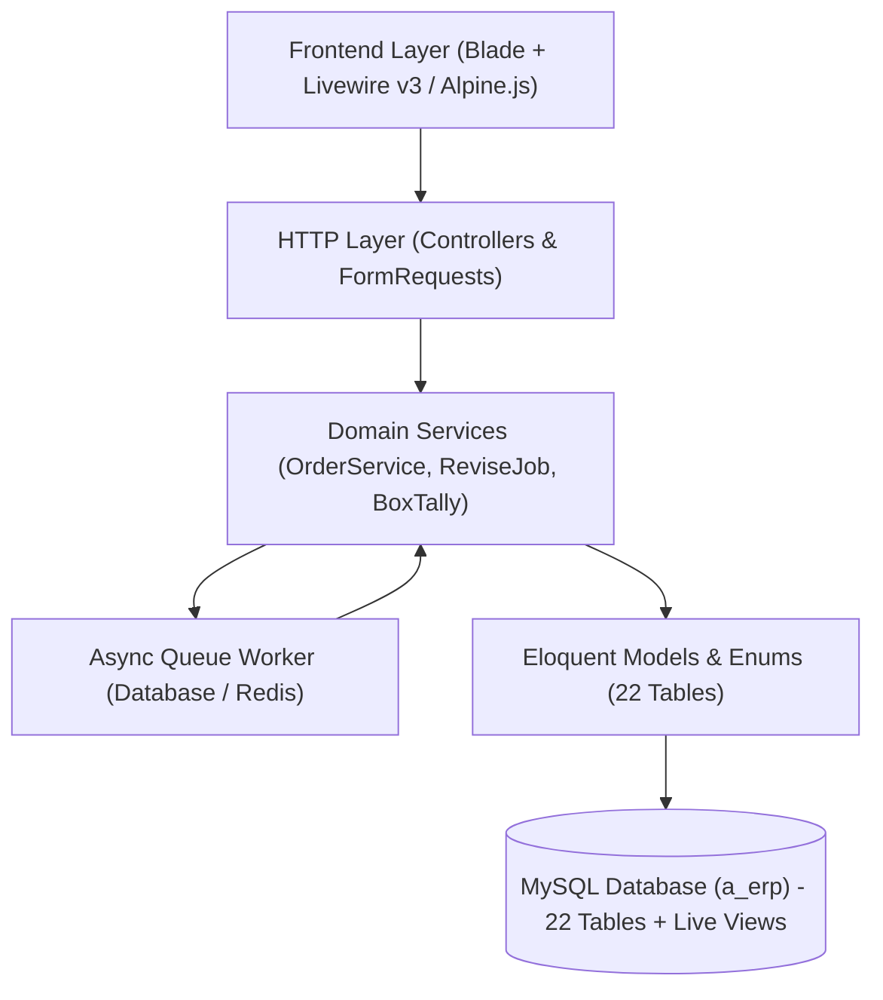
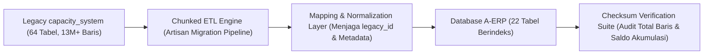

# Dokumen Rencana Persiapan & Roadmap Eksekusi: `A-ERP` (Laravel 12)
*Panduan Rinci Transformasi Sistem Manufaktur Rajut (Knitting Plant) Menuju Enterprise Modern*

> **Dokumen Terkait:** [Blueprint Arsitektur Database Ideal (22 Tabel)](../database/arsitektur_database_capacity_system_ideal.md)  
> **Target Direktori:** `C:\laragon\www\A-ERP`  
> **Basis Framework:** Laravel 12 (PHP 8.2+)  

---

## 1. Ringkasan Eksekutif & Tujuan Proyek

Proyek **A-ERP** bertujuan menggantikan sistem monolitik warisan (`capacity_system` di `CapacityApps`) yang memiliki 64 tabel terfragmentasi (~13 juta baris data) dan file rute raksasa (1.886 baris). 

Transformasi ini tidak sekadar merombak database, melainkan membangun **fondasi ERP modern berbasis Laravel 12** yang berkinerja tinggi, modular, dan siap mendukung otomasi lantai pabrik (seperti *barcode scanner*, *queue worker* untuk import ribuan baris order, dan penghitungan sisa otomatis secara *real-time*).

### Standar & Batasan Global (Global Constraints)
* **PHP Version:** `^8.2.30` (Laragon environment yang sudah aktif).
* **Framework:** `laravel/framework:^12.0`.
* **Database Engine:** MySQL / MariaDB (InnoDB, `utf8mb4_unicode_ci`).
* **Database Name:** `a_erp`.
* **Queue Driver:** Database / Redis (wajib untuk operasi Excel dan rekalkulasi beban mesin).
* **Architecture Style:** Clean Architecture / Domain-Driven Service Layer (tidak menumpuk logika bisnis di Controller).

---

## 2. Arsitektur Tech Stack & Pilihan Paket



| Lapisan (Layer) | Teknologi / Paket | Alasan Pemilihan & Nilai Tambah |
| :--- | :--- | :--- |
| **Backend Framework** | Laravel 12 | Performa tinggi, *streamlined structure*, dukungan *lifecycle* panjang. |
| **Autentikasi & Otorisasi** | Laravel Breeze / Fortify + `spatie/laravel-permission` | Role-based access control baku (Admin, Planner, Supervisor, Operator, Mekanik, QA, Gudang). |
| **Interactive UI** | Livewire v3 + Alpine.js + Tailwind CSS / Bootstrap 5 | Reaktivitas instan tanpa beban kompleksitas arsitektur SPA terpisah. |
| **Excel & Data Processing** | `rap2hpoutre/fast-excel` / `openspout` | *Streaming reader* berkecepatan tinggi, memproses 10.000+ baris revisi order tanpa lonjakan *memory limit*. |
| **Asynchronous Queue** | Laravel Queue Worker (`queue:work`) | Menghilangkan *loading lama/timeout* di browser pengguna saat import file besar. |
| **Database ORM** | Eloquent + Strict Types & Backed Enums | Menggantikan query *string joining* manual CI4 dengan relasi terindeks tipe `BIGINT UNSIGNED`. |
| **Developer Tools** | `barryvdh/laravel-debugbar` & Laravel Pint | Pemantauan *query time*, deteksi N+1 problem, dan standardisasi kode PSR-12. |

---

## 3. Peta Struktur Direktori Aplikasi (Clean Domain Structure)

Untuk mencegah Controller raksasa seperti pada sistem lama, `A-ERP` menerapkan pemisahan tanggung jawab (*Separation of Concerns*):

```text
A-ERP/
├── app/
│   ├── Enums/                     # Backed Enums PHP 8.2 (OrderStatus, DefectCategory, MachineStatus)
│   ├── Http/
│   │   ├── Controllers/           # Controller ramping (hanya menerima request & memanggil Service)
│   │   ├── Requests/              # Validasi input FormRequest terisolasi
│   │   └── Resources/             # API Resources jika diperlukan untuk scanner/tablet
│   ├── Jobs/                      # Job antrean latar belakang (ProcessReviseOrderJob, GenerateReportJob)
│   ├── Models/                    # 22 Eloquent Models dengan strict typing & scopes
│   ├── Services/                  # Logika bisnis inti (OrderService, PlanningService, ProductionService)
│   └── View/Components/          # Komponen UI Blade modular
├── database/
│   ├── migrations/                # 22 Migrasi terstruktur dalam 4 batch domain
│   ├── seeders/                   # Seeder master plant, area, tipe mesin, jenis BS
│   └── schemas/                   # Skrip DDL SQL murni (referensi cadangan)
├── docs/                          # Dokumentasi arsitektur, ERD, dan rencana sprint
├── resources/views/               # View Blade terstruktur per modul
└── routes/
    ├── web.php                    # Rute bersih terbagi dalam grup modul
    └── api.php                    # Rute API untuk barcode scanner / mobile terminal
```

---

## 4. Tahapan Pengerjaan Bertahap (Sprint Roadmap)

### 📌 Fase 0: Inisialisasi Fondasi & Scaffold Laravel 12
* **Tujuan:** Menyiapkan proyek Laravel 12 di `C:\laragon\www\A-ERP` yang terhubung ke database `a_erp`.
* **Rincian Tugas:**
  1. Jalankan `composer create-project laravel/laravel:^12.0 .` di direktori `A-ERP`.
  2. Salin dan sesuaikan konfigurasi `.env`:
     * `DB_CONNECTION=mysql`
     * `DB_DATABASE=a_erp`
     * `QUEUE_CONNECTION=database`
  3. Instal paket inti:
     * `composer require spatie/laravel-permission rap2hpoutre/fast-excel`
     * `composer require --dev barryvdh/laravel-debugbar`
  4. Jalankan `php artisan key:generate` dan tes konektivitas database.
* **Hasil (Deliverable):** Proyek Laravel 12 berjalan bersih dengan `php artisan about` menampilkan versi 12.x dan PHP 8.2.

---

### 📌 Fase 1: Implementasi Migrasi Database & Seeding (22 Tabel)
* **Tujuan:** Menerjemahkan skema DDL yang sudah disetujui menjadi Laravel Migrations resmi yang terversi.
* **Rincian Tugas:**
  1. **Batch 1 (Master Data):**
     * `create_plants_table`
     * `create_factory_areas_table`
     * `create_user_area_access_table`
     * `create_machine_types_table`
     * `create_machines_table`
     * `create_defect_types_table`
     * `create_downtime_reasons_table`
     * `create_company_holidays_table`
  2. **Batch 2 (Order & Planning):**
     * `create_orders_table`
     * `create_order_styles_table`
     * `create_order_shipments_table`
     * `create_order_revisions_table`
     * `create_order_revision_items_table`
     * `create_sample_approvals_table` (PPS)
     * `create_planning_allocations_table`
     * `create_machine_assignments_table`
     * `create_capacity_forecasts_table`
     * `create_monthly_targets_table`
     * `create_order_bookings_table`
  3. **Batch 3 (Produksi & Quality):**
     * `create_production_boxes_table` (dengan indeks komposit & partisi rentang tanggal)
     * `create_box_defects_table`
     * `create_rework_tracking_table`
     * `create_flow_templates_table` & `create_flow_steps_table`
     * `create_wip_movements_table`
  4. **Batch 4 (Logistik & Maintenance):**
     * `create_yarn_stock_balances_table` & `create_yarn_transactions_table`
     * `create_machine_downtimes_table` (dengan *virtual column* durasi menit)
     * `create_needle_consumptions_table`
     * `create_maintenance_tickets_table` & `create_maintenance_ticket_replies_table`
     * `create_audit_logs_table`
  5. **Views & Seeders:**
     * Migrasi pembuatan database view `view_order_shipment_progress` (kalkulasi sisa dinamis).
     * `DatabaseSeeder` mengisi data pabrik, area (`KK9D`, `KK8B`, `ROSSO`, dll.), jenis mesin rajut, dan master cacat.
* **Hasil (Deliverable):** `php artisan migrate:fresh --seed` sukses 100% tanpa error FK.

---

### 📌 Fase 2: Eloquent Domain Models & Backed Enums
* **Tujuan:** Membangun lapisan data yang memiliki *type-safety*, relasi jelas, dan *query scopes*.
* **Rincian Tugas:**
  1. **Buat Backed Enums PHP 8.2:**
     * `OrderStatus` ('DRAFT', 'CONFIRMED', 'IN_PLANNING', 'IN_PRODUCTION', 'COMPLETED', 'CANCELLED')
     * `DepartmentType` ('KNITTING', 'LINKING', 'SETTING', 'PACKING', 'WAREHOUSE', 'QC')
     * `MachineStatus` ('RUNNING', 'IDLE', 'BREAKDOWN', 'MAINTENANCE', 'OFFLINE')
     * `DefectCategory` ('KNITTING_NEEDLE', 'YARN_DEFECT', 'MACHINE_TIMING', 'DIRT_OIL', dll.)
     * `ReworkStatus` ('IN_REPAIR', 'RESOLVED', 'SCRAPPED')
  2. **Definisikan 22 Eloquent Models:**
     * Menetapkan `$fillable`, `$casts`, relasi `belongsTo`, `hasMany`, dan `hasOne`.
     * Menambahkan *Accessors*: misal `OrderShipment::getSisaPairsAttribute()` yang membaca langsung dari agregasi produksi tanpa kolom statis `sisa`.
* **Hasil (Deliverable):** Seluruh model siap diuji via Tinker dan bebas dari error relasi.

---

### 📌 Fase 3: Core Business Services & Queue Workers
* **Tujuan:** Mengisolasi logika bisnis penting manufaktur ke dalam *Service Classes* dan *Background Jobs*.
* **Rincian Tugas:**
  1. **Modul Revise Order (`OrderReviseService` & `ProcessReviseOrderJob`):**
     * Mengadopsi algoritma *3-tier smart matching* yang telah kita uji di `CapacityApps`.
     * Validasi ACID transaction: jika ada selisih pengurangan kuantitas, catat otomatis ke `order_revision_items`.
     * Proteksi mutlak: Baris yang sudah memiliki output di `production_boxes` tidak boleh berkurang di bawah angka produksi riil.
  2. **Modul Box Tally & Barcode Scanner (`ProductionBoxService`):**
     * Input box rajut otomatis menghasilkan barcode unik.
     * Pencatatan pasang bagus (*good pairs*) dan cacat (*defect pairs*) secara atomik.
  3. **Modul Planning & Kapasitas (`CapacityPlanningService`):**
     * Kalkulasi otomatis kebutuhan mesin berdasarkan target pairs dan SMV detik per pasang.
* **Hasil (Deliverable):** Seluruh logika bisnis dapat dieksekusi baik lewat controller web maupun CLI artisan command.

---

### 📌 Fase 4: Antarmuka UI (Blade + Modern Components)
* **Tujuan:** Menyediakan dashboard dan form operasional yang cepat, bersih, dan mudah digunakan oleh staf pabrik.
* **Rincian Tugas:**
  1. **Layout & Navigasi Terstruktur:**
     * Sidebar modular berbasis peran pengguna (Admin, PPIC/Planner, QA, Mekanik, Warehouse).
  2. **Modul Manajemen Order & Revisi:**
     * Halaman upload file Excel revisi order dengan *progress bar* interaktif.
     * Tampilan perbandingan revisi (*before vs after*) dan riwayat pembatalan.
  3. **Modul Monitoring Produksi & Sisa Realtime:**
     * Layar monitoring status order yang menampilkan progres persentase dan sisa order tanpa lag.
* **Hasil (Deliverable):** UI interaktif siap diuji pakai oleh pengguna akhir.

---

### 📌 Fase 5: Pengujian Otomatis & Skrip Migrasi Data (ETL)
* **Tujuan:** Menjamin keandalan sistem dan memindahkan data historis dari database lama.
* **Rincian Tugas:**
  1. **Automated Feature Tests:**
     * `ReviseOrderTest`: Menguji skenario upload revisi dengan kenaikan, penurunan, dan reschedule tanggal kirim.
     * `ZeroProductionLossTest`: Memastikan sistem melempar `ValidationException` jika ada revisi yang memotong kuantitas di bawah produksi fisik yang sudah berjalan.
     * `SisaCalculationTest`: Memastikan sisa selalu konsisten saat ada penambahan output box produksi.
  2. **Skrip ETL Migrasi Data (Legacy `capacity_system` $\rightarrow$ `a_erp`):**
     * Artisan command `php artisan migrate:legacy-data` untuk memetakan data mesin lama (3.036 unit) dan data order aktif ke skema baru.
* **Hasil (Deliverable):** Seluruh *test suite* berstatus hijau (PASS) dan data awal siap pakai.

---

## 5. Strategi Garansi Zero Data Loss ETL (100% Data Preserved: ~13 Juta Baris)

Kekhawatiran hilangnya detail kecil (seperti nama area/factory, riwayat inisial mesin, tipe silinder, riwayat SMV, nomor box, catatan revisi, hingga log audit) **dimitigasi secara sistematis dengan protokol Zero-Loss ETL**:



### 5.1 Pemetaan Detail Kecil Tanpa Terkecuali (Field-Level Preservation)

1. **Detail Area & Factory (Lantai Rajut):**
   * Data `areas` (23 baris), `area_machine` (336 baris), `detail_area_machine` (2.075 baris) diserap utuh ke `plants` dan `factory_areas`.
   * Semua kode unik (`KK9D`, `KK8B`, `KK7A`, `ROSSO`, `SETTING`, dll.), nama gedung, deskripsi departemen, dan denah penempatan mesin per area **100% terjaga**.
2. **Detail Inventaris Mesin (3.036 Unit):**
   * Data `machines`, `data_mesin`, `master_mc`, `data_cylinder`, `mesin_pernomor`, dan `mesin_perinisial`:
     * Nomor mesin fisik (`machine_number` / nomor MC unik).
     * Inisial planning per area (misal: inisial `A`, `B`, `C` di area tertentu).
     * Spesifikasi mekanis: diameter silinder (inci), jumlah jarum (*needle count*), merek mesin (Lonati, Santoni, Dakong), dan status operasi.
3. **Detail Order, Style, & Delivery (284k Baris):**
   * Seluruh atribut fisik kaos kaki dari `apsperstyle`: PO number, model/style, warna, size, target SMV, berat gramasi (`unit_weight_gram`), `gw_dz`, inisial, dan riwayat delivery dipetakan presisi ke `orders`, `order_styles`, dan `order_shipments`.
4. **Detail Transaksi Produksi & Box Barcode (1,89 Juta Baris):**
   * Setiap nomor barcode box, tanggal rajut, shift (1/2/3), operator pelaksana, mesin yang merajut, pasang bagus (*good pairs*), dan pasang BS (*defect pairs*) dipindahkan utuh ke `production_boxes`.
5. **Detail Kualitas, Reject, & Perbaikan (3,18 Juta BS + 841k Perbaikan):**
   * Seluruh rincian jenis BS (`master_deffect`), jumlah cacat per jenis, riwayat masuk cuci/perbaikan, hasil perbaikan (lolos/BS murni) tersimpan di `defect_types`, `box_defects`, dan `rework_tracking`.
6. **Detail Downtime & Servis Mekanik (1,38 Juta Baris):**
   * Setiap menit mesin berhenti, alasan kerusakan, teknisi penanggung jawab, serta konsumsi jarum patah masuk ke `machine_downtimes` dan `needle_consumptions`.

### 5.2 Mekanisme Jejak Audit (`legacy_id` Traceability)
Setiap tabel di `A-ERP` dilengkapi kolom `legacy_id` (atau tabel audit perantara `migration_legacy_maps`) sehingga:
* Setiap baris data di `A-ERP` memiliki referensi langsung ke ID asalnya di `capacity_system`.
* Tim pabrik dapat melakukan audit silang kapan saja jika ingin memeriksa dokumen atau rekap tahun-tahun sebelumnya.

### 5.3 Automated Checksum Verification (Validasi Matematis 100%)
Proses migrasi dinyatakan selesai **HANYA JIKA** seluruh persamaan rekonsiliasi bernilai sama persis ($0\text{ selisih}$):

$$\sum \text{Mesin}_{\text{legacy}} = \sum \text{Mesin}_{\text{A-ERP}} = 3.036\text{ unit}$$
$$\sum \text{Good Pairs}_{\text{legacy}} = \sum \text{Good Pairs}_{\text{A-ERP}}$$
$$\sum \text{BS Pairs}_{\text{legacy}} = \sum \text{BS Pairs}_{\text{A-ERP}}$$
$$\sum \text{Order Pairs}_{\text{legacy}} = \sum \text{Order Pairs}_{\text{A-ERP}}$$
$$\sum \text{Downtime Minutes}_{\text{legacy}} = \sum \text{Downtime Minutes}_{\text{A-ERP}}$$

---

## 6. Matriks Risiko Kritis & Mitigasi (Review Focus)

| Potensi Masalah / Risiko | Skenario Lapangan | Langkah Mitigasi di A-ERP |
| :--- | :--- | :--- |
| **1. Excel Memory Exhaustion** | Staf mengupload file Excel revisi dengan 5.000+ baris data sekaligus. | Menggunakan `FastExcel` streaming reader dan memproses parsing di latar belakang via *Queue Worker*. |
| **2. Concurrency Race Condition** | Dua operator menginput box produksi untuk model dan mesin yang sama secara bersamaan. | Menerapkan `DB::transaction()` dengan *Pessimistic Locking* (`lockForUpdate()`) pada level batch. |
| **3. Reschedule Tanggal Kirim** | Buyer mengubah tanggal delivery tanpa mengubah total kuantitas. | Jadwal disimpan pada `order_shipments` (1:N), sehingga perubahan tanggal tidak memecah ID model induk. |
| **4. Human Error Pengurangan Order** | Revisi memangkas kuantitas di bawah jumlah barang yang sudah terlanjur dirajut mesin. | Sistem melakukan validasi silang otomatis ke `production_boxes` dan menolak transaksi jika `new_qty < produced_qty`. |

---

## 6. Rencana Aksi Segera (Immediate Action Plan)

Setelah dokumen perencanaan ini disetujui, langkah eksekusi langsung pertama adalah:
1. **Eksekusi Inisialisasi Laravel 12** di `C:\laragon\www\A-ERP`.
2. **Setup Konfigurasi Environment & Database** (`.env` terhubung ke MySQL `a_erp`).
3. **Instalasi Paket Inti** (`spatie/laravel-permission`, `rap2hpoutre/fast-excel`, `barryvdh/laravel-debugbar`).
4. **Scaffolding Migrations Batch 1** (Master Data).
